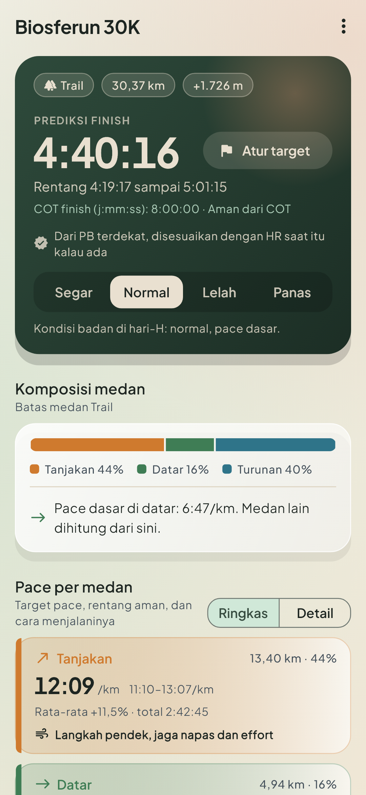
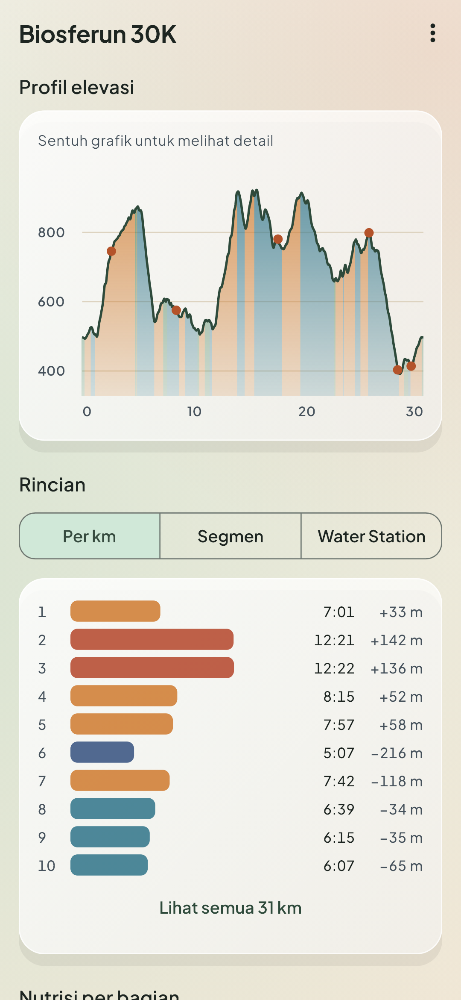
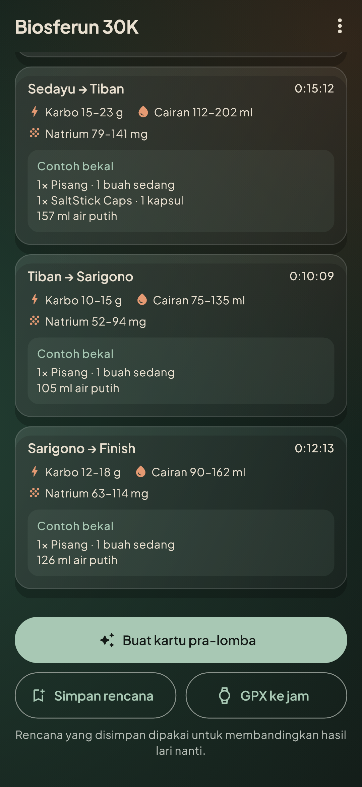
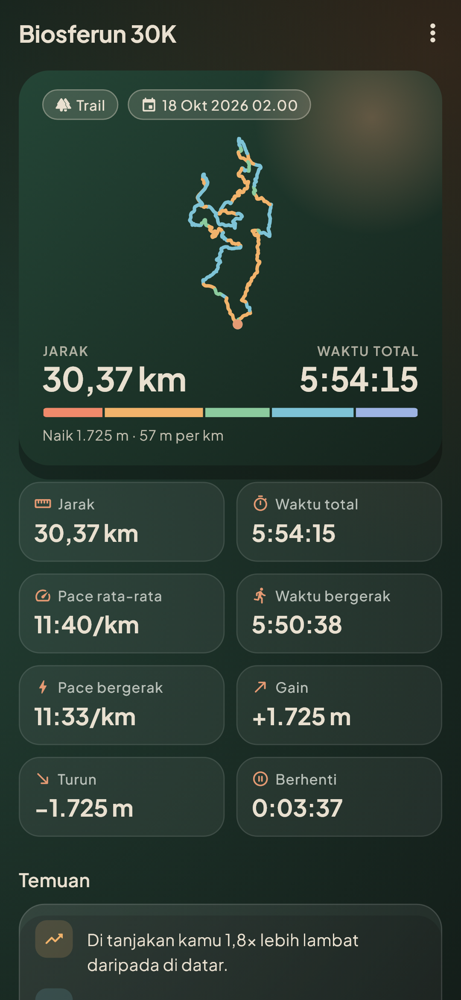
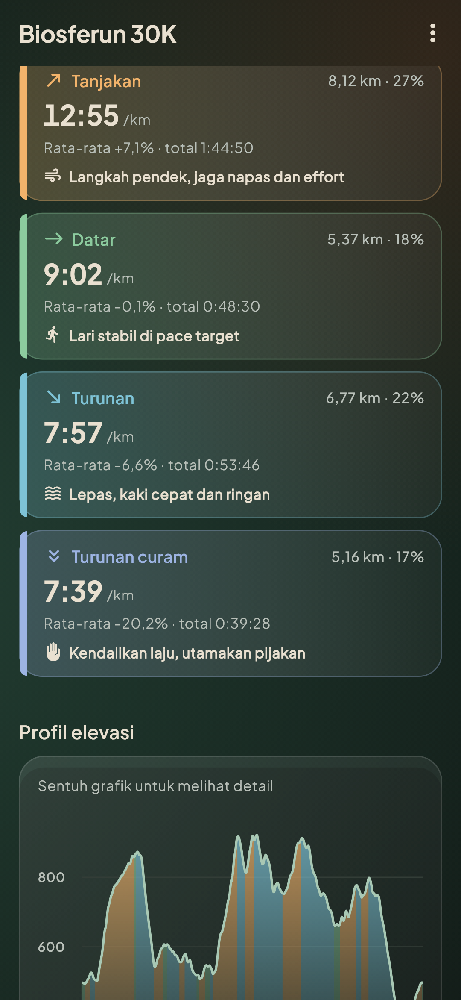
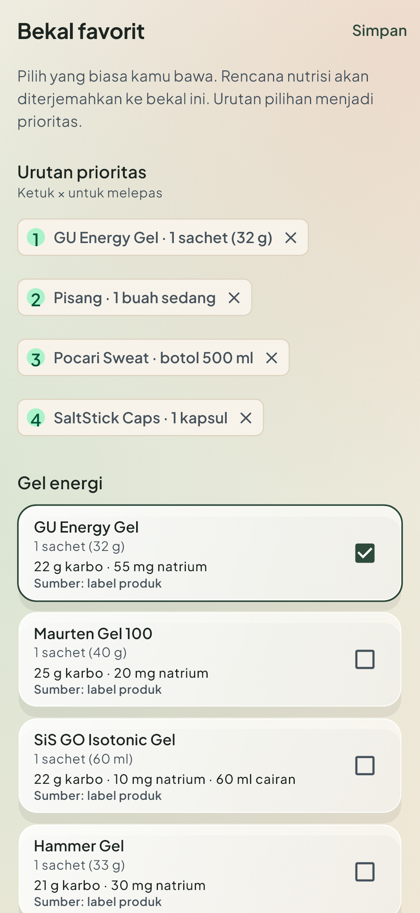
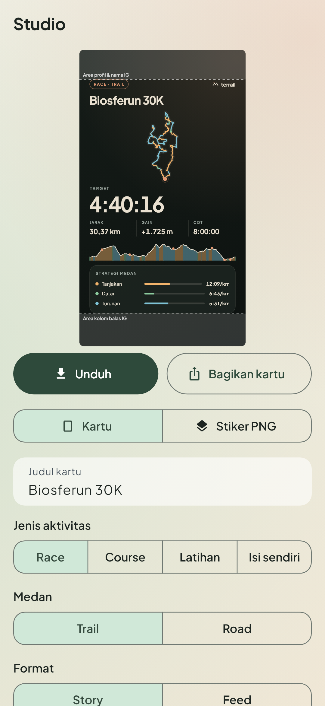
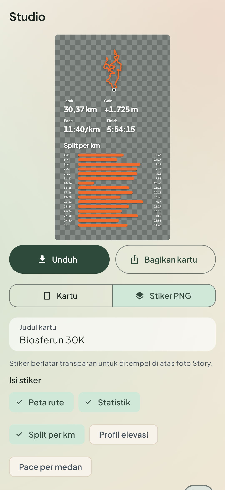

  

<h1 align="center">Terrail</h1>

  Analisis dan strategi lari trail dan road, plus studio kartu dan stiker untuk sebelum dan sesudah lari. 
  Gratis, tanpa akun, data tetap di HP. Untuk Android.

  <a href="https://github.com/alimxtar/terrail/releases/latest"><b>⬇️ Unduh APK terbaru</b></a>

---

Impor file GPX rute lomba, dan Terrail menghitung target pace untuk setiap tanjakan, jalan datar, dan turunan, lengkap dengan cara menjalaninya. Setelah lari, impor rekaman dari jam untuk melihat pace per medan, split per km, dan temuan otomatis. Hasilnya bisa dipamerkan sebagai kartu atau stiker transparan untuk Instagram Story.

## Tangkapan layar

<table>
  <tr>
    <td align="center"> Prediksi atau target finish</td>
    <td align="center"> Profil elevasi dan split per km</td>
    <td align="center"> Bekal per segmen antar-WS</td>
  </tr>
  <tr>
    <td align="center"> Analisis setelah lari</td>
    <td align="center"> Pace aktual per medan</td>
    <td align="center"> Bekal favorit</td>
  </tr>
  <tr>
    <td align="center"> Kartu pra-lomba dengan zona aman Story</td>
    <td align="center"> Stiker PNG transparan</td>
    <td></td>
  </tr>
</table>

Data di tangkapan layar memakai rute publik Biosferun 30K 2026.

## Fitur

### Strategi
- **Pace per medan.** Rute dibagi menjadi tanjakan curam, tanjakan, datar, turunan, dan turunan curam. Setiap medan punya target pace, rentang aman, porsi jarak, dan arahan seperti "jalan cepat (power hike)" atau "kendalikan laju, utamakan pijakan".
- **Target finish.** Isi target, dan semua pace medan menyesuaikan supaya totalnya pas.
- **Data seadanya tetap jalan.** Tanpa data apa pun, Terrail memakai perkiraan kasar dan menandainya dengan jelas. Makin lengkap datamu (PB, HR saat PB, berat badan, atau hasil lari di rute itu), makin akurat prediksinya.
- **Skenario hari-H.** Segar, Normal, Lelah, atau Panas, lengkap dengan efeknya ke pace.
- **Rincian per km, per segmen, dan per WS.** Ada juga status COT kalau batas waktu diisi.
- **Trail dan road.** Batas kemiringan berbeda untuk keduanya. Ada juga split road tanpa GPX untuk 5K sampai marathon.
- **Ekspor GPX** ke aplikasi jam.

### Bekal
- Kebutuhan karbohidrat, cairan, dan natrium per segmen antar-WS diterjemahkan ke bekal nyata, misalnya "1× gel GU, 1× pisang, Pocari Sweat 500 ml, 1 kapsul garam".
- Sekitar 40 pilihan yang umum di Indonesia: pisang, kurma, ubi, nasi kepal, madu, gel (GU, Maurten, SiS, Hammer), Pocari Sweat, Mizone, Isoplus, Hydro Coco, air kelapa, oralit, Tailwind, SaltStick, dan lainnya.
- Angka diambil dari label produsen dan USDA FoodData Central. Produk tanpa label resmi ditandai sebagai perkiraan.

### Hasil
- Jarak, waktu total, pace rata-rata, waktu dan pace bergerak, gain, turun, waktu berhenti, dan HR kalau tersedia.
- Angka mengikuti ringkasan jam. Untuk file Huawei Health, jarak, waktu, dan gain sama persis dengan aplikasi jam.
- Pace aktual per medan, termasuk perbandingan dengan rencana yang disimpan sebelum lomba.
- **Temuan otomatis**, misalnya "turunan curammu lebih lambat dari turunan biasa", positive atau negative split, km tercepat dan terlambat, serta total waktu berhenti.
- Hubungkan rekaman ke rute lomba untuk waktu tiba di WS dan waktu chip resmi.
- **Ambil dari Strava** lewat Strava API resmi: pilih aktivitas dari daftar, dan data masuk lengkap dengan **HR dan cadence**. Gratis, tanpa langganan Strava.
- **HR dan cadence per medan**, misalnya HR di tanjakan dibanding di datar.
- **Sinkron manual:** ketuk Sinkronkan di daftar aktivitas Strava, lalu **Impor semua** untuk mengambil semua aktivitas baru sekaligus.
- **Putuskan Strava** kapan saja dari menu Saya → Strava. Terrail mencabut izinnya di Strava, dan panduan langkahnya tersedia di layar.
- **Bagikan ke Terrail:** file GPX, TCX, KML, KMZ, dan FIT dari aplikasi jam atau pengelola file bisa dibagikan atau dibuka langsung dengan Terrail.

### Studio
- **Kartu** story (9:16) dan feed (4:5) dengan latar gradasi atau foto sendiri.
- **Label bebas:** Race, Course, Latihan, atau tulis sendiri, ditambah Trail atau Road.
- **Zona aman Instagram Story.** Teks dijauhkan dari foto profil dan kolom balas.
- **Stiker PNG transparan** untuk ditempel di atas foto: jejak rute, statistik, split per km, elevasi, dan pace per medan. Bisa rata kiri, tengah, atau kanan; diletakkan di atas, tengah, atau bawah; dengan ukuran kecil sampai besar.
- **Data lengkap di kartu:** HR rata-rata dan maksimal, cadence, waktu bergerak, dan HR per medan untuk hasil lari; pace target dan jumlah WS untuk pra-lomba.
- 13 warna rute ditambah warna medan, serta ekspor HD atau 4K.
- Modul yang datanya tidak ada otomatis nonaktif, lengkap dengan alasannya.

### Lainnya
- Bahasa Indonesia dan English.
- Tema terang, gelap, atau mengikuti sistem.
- Kamus istilah trail dan road.

## Pasang

1. Buka [halaman rilis terbaru](https://github.com/alimxtar/terrail/releases/latest).
2. Unduh **`Terrail-1.0.0-arm64.apk`**, yang cocok untuk hampir semua HP Android sejak 2017. Untuk HP lama 32-bit, pilih `Terrail-1.0.0-armv7.apk`.
3. Buka file itu. Kalau Android meminta izin, izinkan browser atau aplikasi file memasang aplikasi dari sumber ini.
4. Pembaruan berikutnya cukup dipasang di atas versi lama. Data tetap aman.

Butuh Android 7.0 atau lebih baru.

## Cara pakai singkat

1. **Rute lomba:** unduh GPX, KML, atau KMZ dari panitia, lalu buka tab **Strategi** dan pilih **Impor file**.
2. **Rekaman lari:** ekspor GPX dari aplikasi jam (misalnya Huawei Health, Garmin Connect, atau COROS), lalu bagikan ke Terrail atau impor di tab **Hasil**.
3. **Dari Strava (sekali siapkan):**
   1. Buka [strava.com/settings/api](https://www.strava.com/settings/api) di browser lalu buat aplikasi API: nama bebas (misalnya Terrail), Website `https://github.com/alimxtar/terrail`, dan **Authorization Callback Domain: `localhost`**.
   2. Di Terrail, buka **Saya → Strava**, lalu tempel **Client ID** dan **Client Secret** dan ketuk **Hubungkan Strava**.
   3. Setujui di aplikasi Strava atau browser. Setelah itu, tombol **Dari Strava** di tab Hasil menampilkan daftar aktivitasmu.

   Strava meminta setiap pengguna membuat aplikasi API sendiri, karena aplikasi API baru hanya bisa dipakai akun pembuatnya.
4. **Kartu atau stiker:** buka tab **Studio**, pilih rute atau hasil lari, atur tampilannya, lalu **Unduh** atau **Bagikan**.

Format yang didukung: GPX, TCX, KML, KMZ, dan FIT.

## Privasi

- Semua data tersimpan di HP. Tanpa akun, server, atau iklan.
- Aplikasi tidak meminta izin lokasi atau notifikasi. Izin internet hanya dipakai untuk Strava, dan hanya menghubungi server Strava. Izin galeri hanya untuk Android 10 ke bawah.
- Sandi Strava tidak pernah dilihat Terrail, karena login dilakukan di aplikasi Strava atau browser. Client Secret dan token Strava disimpan terenkripsi di HP.
- Backup otomatis Android dimatikan, sehingga data lari tidak tersalin ke cloud.

## Catatan

- Prediksi dan rencana bekal adalah titik awal untuk latihan dan perencanaan, bukan anjuran medis. Sesuaikan dengan kondisi tubuh dan uji di latihan sebelum lomba.
- Label produk bisa berubah. Cek kemasan sebelum hari-H.
- Menemukan bug atau punya saran? Buka [Issues](https://github.com/alimxtar/terrail/issues).

## Kredit

- Font [Plus Jakarta Sans](https://github.com/tokotype/PlusJakartaSans) (SIL Open Font License 1.1).
- Data gizi dari label produsen dan [USDA FoodData Central](https://fdc.nal.usda.gov/).

---

<b>English</b>

Terrail is a free, offline Android app for trail and road runners. Import a race GPX to get target pace for every climb, flat and descent (scaled to your finish target), a fuel plan translated into real foods and products, and km splits. Import a run from your watch for terrain pace, splits and automatic insights. The studio turns both into story or feed cards and transparent PNG stickers, with an Instagram Story safe zone. Import your own Strava runs with heart rate and cadence through the official Strava API, using your own free API application. No Terrail account, all data stays on the phone; the internet permission is only used for Strava. Download the APK from the [latest release](https://github.com/alimxtar/terrail/releases/latest); Android 7.0 or newer.

Dibuat oleh <a href="https://github.com/alimxtar">Ali Mochtar Ahdina S.</a> · © 2026. Aplikasi gratis untuk pemakaian pribadi; source code tidak dibuka.

